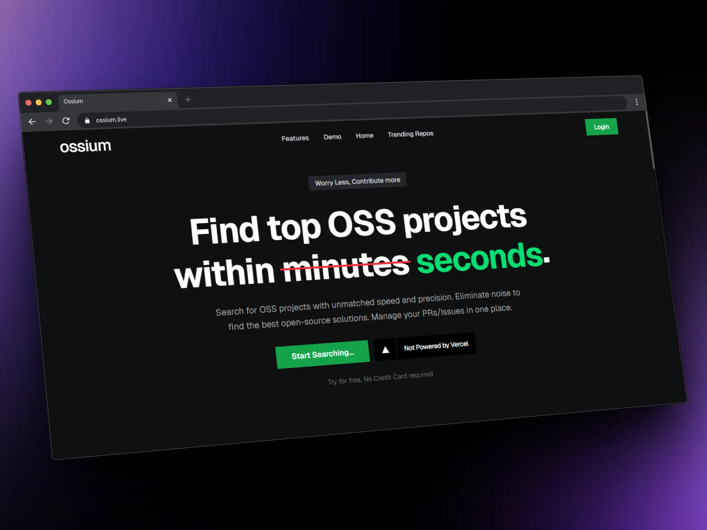
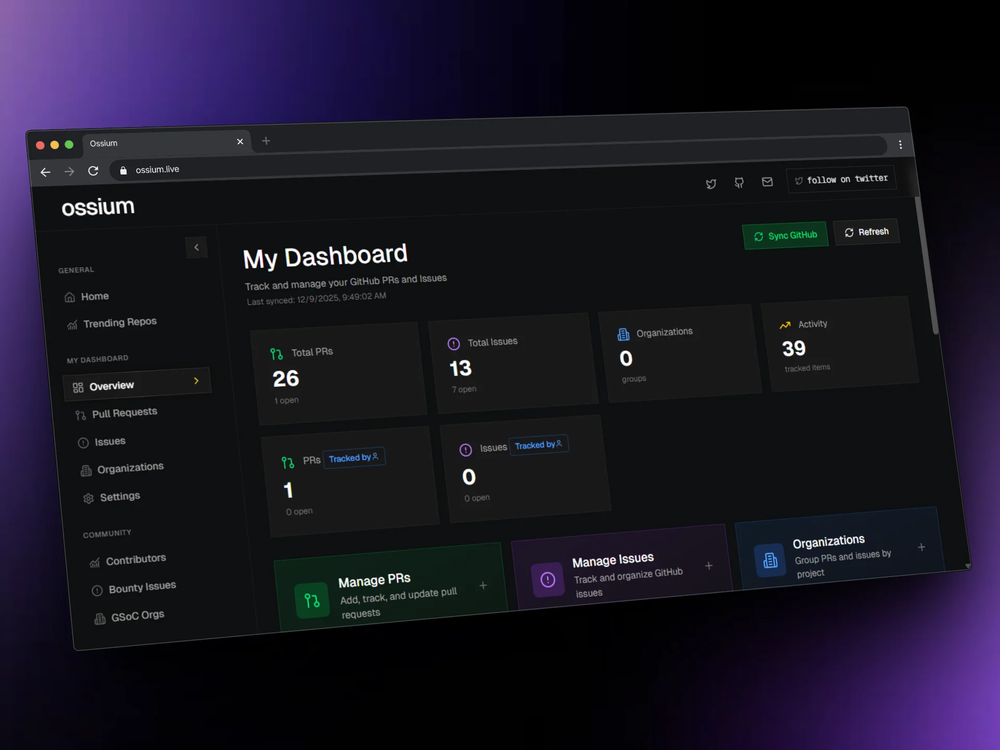
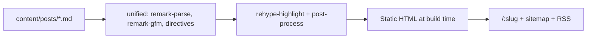

# ossium Blog

> From first issue to first merge — practical guides, how-tos, and Q&A that help
> developers land their first open-source contribution, crack GSoC, and ship with
> confidence.

[](https://github.com/MxCorpIn/blogs/actions/workflows/ci.yml)
[](https://github.com/MxCorpIn/blogs)
[](https://github.com/MxCorpIn/blogs/commits/main)
[](https://github.com/MxCorpIn/blogs/blob/main/package.json)
[](https://github.com/MxCorpIn/blogs/blob/main/CONTRIBUTING.md)
[](https://github.com/MxCorpIn/blogs/blob/main/LICENSE)

**Live site:** [blog.ossium.in](https://blog.ossium.in) ·
**Main product:** [ossium.in](https://ossium.in) ·
**Contribute:** [CONTRIBUTING.md](CONTRIBUTING.md) ·
**Issues:** [open an issue](https://github.com/MxCorpIn/blogs/issues)



## Table of contents

- [Why ossium?](#why-ossium)
- [Features](#features)
- [Screenshots](#screenshots)
- [Tech stack](#tech-stack)
- [Quickstart](#quickstart)
- [Writing posts](#writing-posts)
- [Project structure](#project-structure)
- [Contributing](#contributing)
- [License](#license)
- [Support](#support)

## Why ossium?

Generic dev blogs teach syntax. ossium teaches **getting merged**: finding the
right issue, writing a reviewable PR, and navigating programs like GSoC and
Hacktoberfest.

| If you use…           | You get…                                   | With ossium you get…                                  |
| --------------------- | ------------------------------------------ | ----------------------------------------------------- |
| Medium / Dev.to posts | One-off tutorials, paywalls, mixed quality | A curated path: beginner → first PR → GSoC-ready      |
| Official program docs | Complete but dense reference material      | Opinionated, step-by-step playbooks with examples     |
| Generic SEO roundups  | “Top 10 tools” with no workflow            | Workflows tied to real contributor tasks and tools    |
| A from-scratch blog   | Weeks of CMS, SEO, and theme setup         | Markdown-first SSG with search, SEO, and RSS built in |

## Features

**Write in Markdown, ship a fast site.**

- 📝 **Markdown-first** — every post is a `.md` file with typed YAML
  frontmatter. No CMS, no database.
- ⚡ **Static generation** — all pages pre-rendered at build time for fast
  loads and strong SEO.
- 🔍 **Search + filters** — instant client-side search across titles, tags,
  and keywords, with `article` / `guide` / `howto` / `question` and category
  filters.
- ⭐ **Featured rail** — sticky spotlight column for must-read posts.
- 🌓 **Light/dark theme** — dark by default, persisted, flash-free toggle.
- 📈 **SEO out of the box** — per-post metadata, `Blog` + `FAQ` JSON-LD,
  `sitemap.xml`, `robots.txt`, and an RSS 2.0 feed (`/feed.xml`).
- ⏱️ **Reading time + related posts** — ~200 wpm estimates and ranking by
  category, type, and shared tags.
- 🖼️ **Galleries + code windows** — `:::gallery` directive for responsive
  image grids, captioned figures, and syntax-highlighted code blocks.

## Screenshots

| Landing                                                | Dashboard                                                                     |
| ------------------------------------------------------ | ----------------------------------------------------------------------------- |
|  |                   |
| Search, filters, and the featured rail.                | Where readers put the guides into practice on [ossium.in](https://ossium.in). |

Open Graph preview (`/demo/oss_og-toposspage.png`) powers link unfurls on
social and chat apps.

## Tech stack

| Layer           | Choice                                                                                              |
| --------------- | --------------------------------------------------------------------------------------------------- |
| Framework       | [Next.js](https://nextjs.org) 16 (App Router, SSG)                                                  |
| UI              | [React](https://react.dev) 19 + [Tailwind CSS](https://tailwindcss.com) v4                          |
| Content         | Markdown + YAML frontmatter (`content/posts/`)                                                      |
| Rendering       | Server-side [unified](https://unifiedjs.com) pipeline (`remark`/`rehype`) + `:::gallery` directives |
| Fonts           | Inter (body), General Sans (headings), JetBrains Mono (code) via CDN                                |
| Language        | TypeScript (strict)                                                                                 |
| Package manager | [pnpm](https://pnpm.io) 11.15.1 (via `packageManager` + Corepack)                                   |

How a post becomes a page:



## Quickstart

### Prerequisites

- **Node.js 20+** (see `engines` in `package.json`)
- **pnpm 11+** — `corepack enable` activates the pinned `pnpm@11.15.1`

### Run it locally

```bash
git clone https://github.com/MxCorpIn/blogs.git
cd blogs
pnpm install
cp .env.example .env
pnpm dev
```

Open <http://localhost:3000>.

| Variable              | What it does                                                                                                                        |
| --------------------- | ----------------------------------------------------------------------------------------------------------------------------------- |
| `NEXT_PUBLIC_APP_URL` | Base URL for canonical links, sitemap, RSS, and OG images. `http://localhost:3000` locally, `https://blog.ossium.in` in production. |

See [.env.example](.env.example) for the annotated list.

### Build for production

```bash
pnpm build && pnpm start
```

### Verify before you push

```bash
pnpm lint && pnpm typecheck && pnpm format:check && pnpm test && pnpm build
```

## Writing posts

1. Create `content/posts/your-slug.md` — the filename is the URL.
2. Add frontmatter (full schema: [content/posts/README.md](content/posts/README.md)).
3. Write Markdown — galleries via `:::gallery columns=3`, captions via image
   alt text.
4. Preview at `/{slug}` — sitemap and RSS pick up published posts automatically.

```yaml
---
title: "Clear, keyword-aware title"
description: "1-2 sentences for SEO meta and cards (~150-160 chars ideal)."
type: article | guide | howto | question
category: contribution | gsoc | github | career | tools | programs | beginners
tags: [tag-one, tag-two]
keywords: [seo keyword one, seo keyword two]
publishedAt: 2026-07-11
updatedAt: 2026-07-11
author: ossium
authorUrl: https://ossium.in
featured: false
draft: false
image: /demo/oss_landingpage.webp
answerSummary: "Only for type=question - short answer for FAQ rich results."
---
```

Set `draft: true` to keep a post out of production until it is ready.

## Project structure

```
blogs/
├── app/                  # App Router pages, layouts, SEO routes
│   ├── [slug]/page.tsx   # Post pages (SSG via generateStaticParams)
│   ├── BlogListing.tsx   # Search, filters, featured rail
│   ├── feed.xml/         # RSS 2.0 feed
│   ├── sitemap.ts        # Sitemap (listing + every post)
│   ├── robots.ts         # robots.txt
│   └── layout.tsx        # Theme, metadata, fonts
├── components/blog/      # PostCard, MarkdownBody, ShareButton
├── components/landing/   # Navbar, Footer, DashedFrame
├── components/theme/     # ThemeToggle
├── content/posts/        # Markdown posts + frontmatter schema README
├── lib/content/          # Loading, parsing, related posts, types
├── lib/markdown/         # :::gallery directives + server renderer
└── public/demo/          # Landing, dashboard, and OG preview images
```

## Contributing

Code, content, and docs all count. Start with
[CONTRIBUTING.md](CONTRIBUTING.md) — branch naming, Conventional Commits, and
the PR checklist. All interaction follows the
[Code of Conduct](CODE_OF_CONDUCT.md).

| Way to help | Example                                      |
| ----------- | -------------------------------------------- |
| ✍️ Content  | Fix a typo, update a stale guide, add a post |
| 💻 Code     | Search, SEO, performance, accessibility, DX  |
| 🧭 Triage   | Reproduce bugs, answer questions, review PRs |
| 📚 Docs     | Clarify setup, improve this README           |

Thanks to everyone who has contributed code, content, and reviews:

<a href="https://github.com/MxCorpIn/blogs/graphs/contributors">
  
</a>

## License

- **Code** (`app/`, `components/`, `lib/`, configs) — [MIT License](LICENSE)
- **Content** (`content/posts/`) — © Ossium, all rights reserved. Do not
  republish posts without permission.

See [CHANGELOG.md](CHANGELOG.md) for release history.

## Support

- 📧 Email [help@ossium.in](mailto:help@ossium.in)
- 🐛 [Open an issue](https://github.com/MxCorpIn/blogs/issues)
- 🔒 Security issues: see [SECURITY.md](SECURITY.md)
